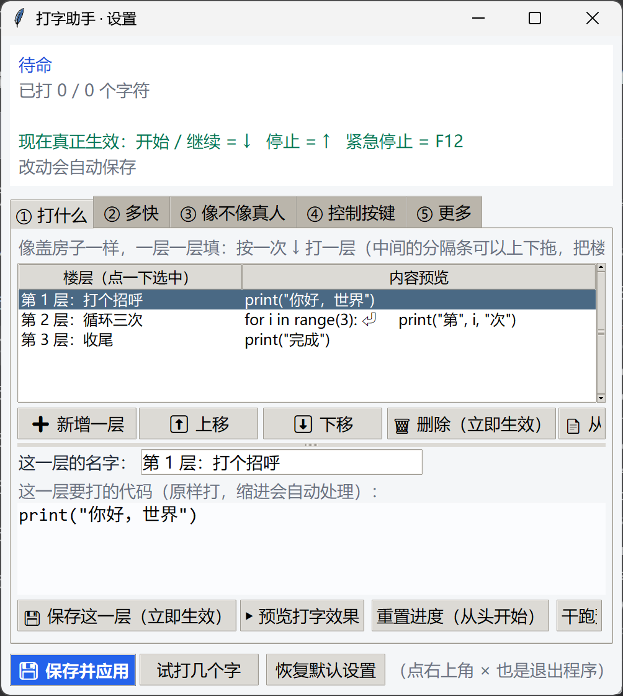
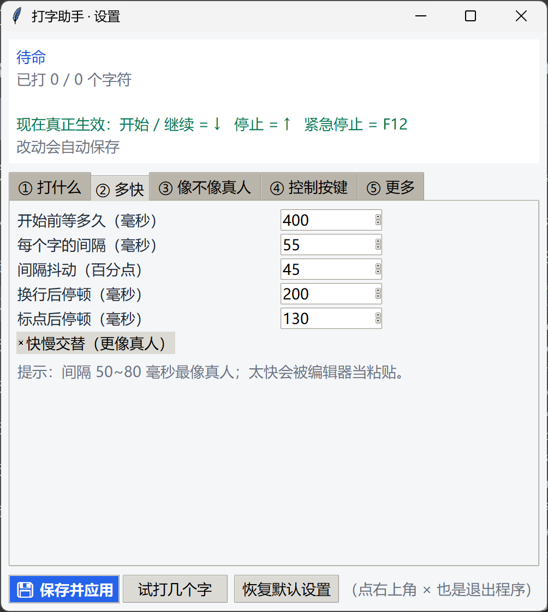
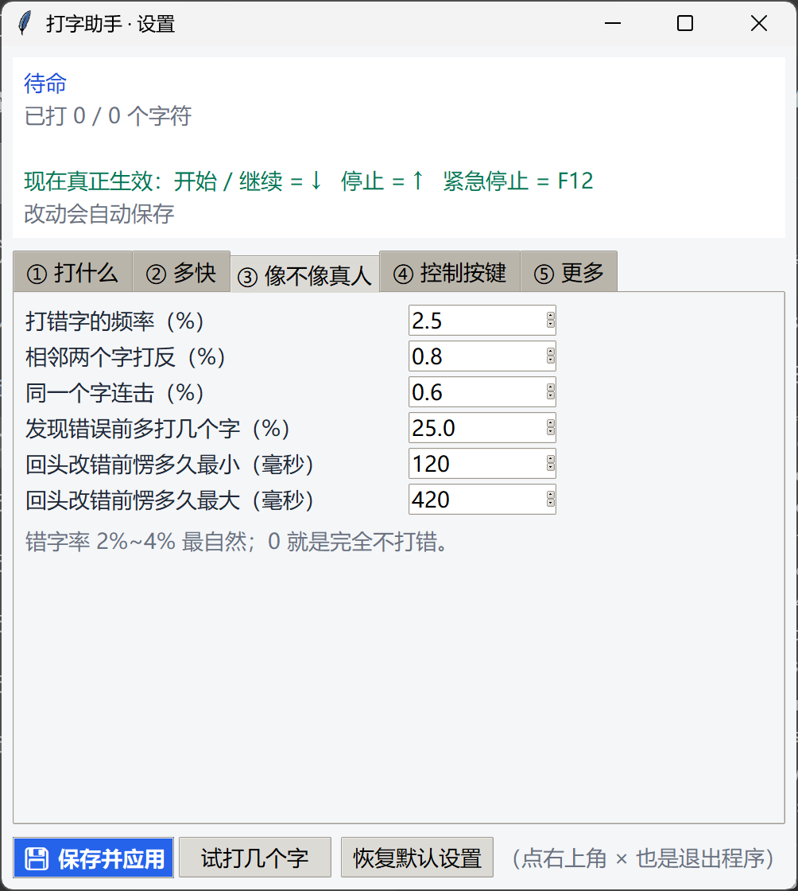
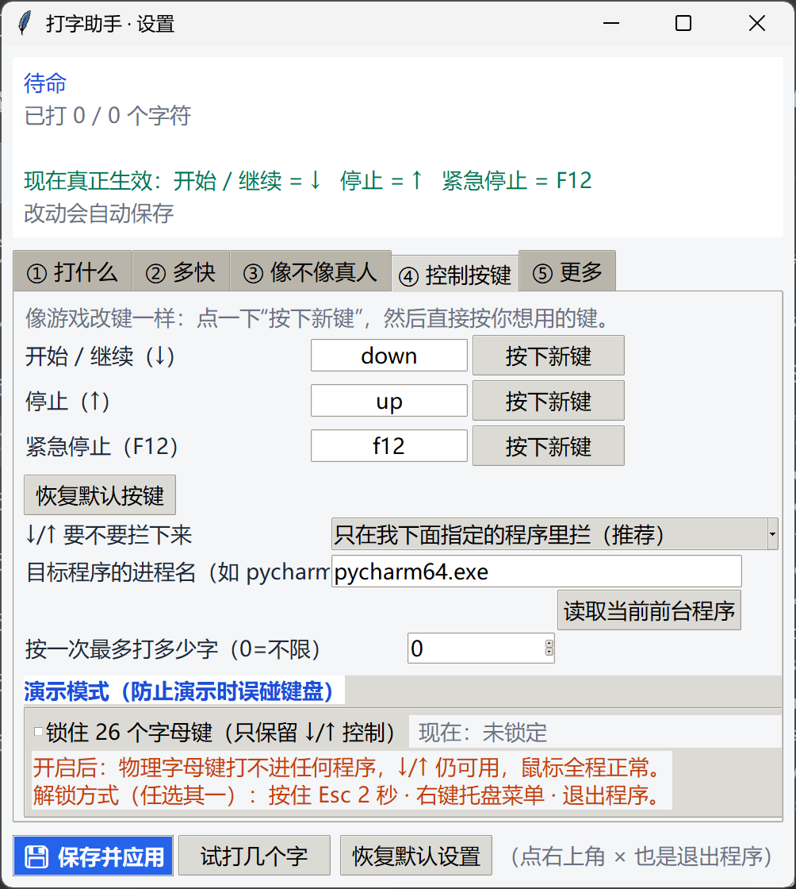
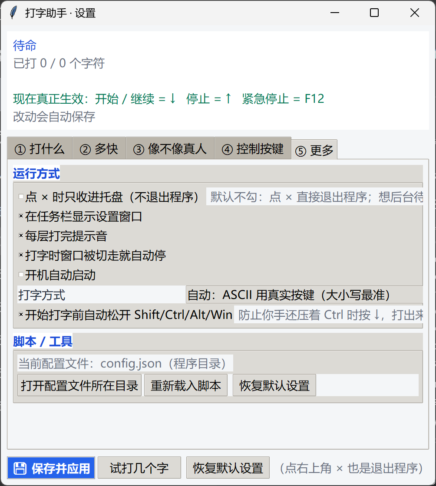

<div align="center">

# ⌨️ 打字助手 · AutoTyper

**一层一层、像真人一样把文字打出来的 Windows 桌面工具**

<p>
  
  
  
  
  
</p>

<a href="#download">下载安装</a> ·
<a href="#features">功能特性</a> ·
<a href="#quickstart">快速上手</a> ·
<a href="#screenshots">界面截图</a> ·
<a href="#changelog">更新日志</a> ·
<a href="#build">源码与打包</a> ·
<a href="#faq">常见问题</a>

</div>

---

<a id="about"></a>

## 📝 这是什么

**打字助手（AutoTyper）** 是一个绿色免安装的 Windows 桌面小工具：你把要打的内容按「楼层」分好，然后按一下 `↓`，它就会**一层一层、像真人一样**把文字打到你当前选中的程序里。

它不是简单地「粘贴文本」——它会模拟真人打字的节奏：

- 按键之间有快有慢、有随机抖动，不会像机器人一样匀速；
- 会偶尔打错字（按到旁边的键、两个字母打反、重复一个字母），然后停顿一下、退格改对；
- 有时会「先打后改」，多打几个字再回头修正；
- 遇到标点、换行会自然停顿，偶尔还有「思考」的小停顿。

同时它又是一个正经的桌面程序：全局热键、托盘待命、设置界面自动保存、焦点切换自动暂停、一键紧急停止。

> 整个项目**只用 Python 标准库 + Windows 系统 API**，没有第三方运行时依赖；界面用 tkinter/ttk，键盘注入用 `SendInput`，全局热键用低级键盘钩子（`WH_KEYBOARD_LL`），托盘用 `Shell_NotifyIconW`，全部通过 `ctypes` 直接调用。

<a id="features"></a>

## ✨ 功能特性

### 🧱 分层打字
- 按「楼层」组织内容：每按一次 `↓` 打一层，适合分步骤演示、分段输入；
- 也可以直接载入脚本文件，支持**按行分段**或**每 N 个字符分段**；
- 自动识别代码缩进（Python / C/JS / 制表符等常见风格），不会把缩进打歪；
- 记住进度（断点续打），关掉重开还能接着打；
- 支持**保存 / 载入本地演示**：把当前所有楼层存成 `.demo.json` 文件，备份、换电脑或发给别人都能直接用。

### 🎭 拟人化节奏
- 基础字间隔 + 随机抖动（可调范围）；
- 快慢交替的 **burst 模式**，更接近真人敲键盘的手感；
- **思考停顿**：随机在某个位置停一下再继续；
- **错字与自我修正**：邻近键误触、字母换位、重复字母，然后退格改对；
- **晚发现错误**：偶尔先打错几个字、再回头退格修改；
- 标点、换行、空格的停顿时长都可以单独设置。

### 🎯 打字习惯校准（v1.1.0 新增）
- 「③ 像不像真人」底部新增「我的打字习惯」：照着示例正常打一段，自动测出你的**中位按键间隔、节奏抖动、字速、退格率**；
- 一键把测出来的习惯套用到每字间隔、间隔抖动、快慢交替、空格 / 标点 / 换行停顿、错字率与改错延迟；
- 只记录按键之间的时间间隔，**不保存你打的内容**；随时可以重新校准或清除记录。

### ⌨️ 全局热键与安全
- 默认热键：`↓` 开始 / 继续，`↑` 停止，`F12` 紧急停止（像游戏改键一样可以自己改）；
- **重置进度热键**：可在「④ 控制按键」给「重置进度」绑一个键（默认不绑定，防止误按），按一下立即回到第 1 层重新开始；
- **改键即生效**：点「按下新键」后直接按你想用的键即可（焦点在哪都行），确认后立刻写回配置并重启全局热键；
- **目标程序限定**：只在你指定的程序窗口里拦截 `↓/↑`，不影响其他软件；
- **焦点守卫**：打字过程中窗口被切走会自动停下；
- **修饰键释放**：开始前自动松开还压着的 Shift/Ctrl/Alt/Win，避免变成快捷键；
- **演示模式**：可锁住 26 个字母键，防止演示时误碰键盘，按住 `Esc` 2 秒解锁；
- 单实例运行，不会重复启动。

### 🖥️ 桌面体验
- 设置界面（tkinter/ttk）：楼层编辑、速度/拟人度、改键、更多选项，**改完自动保存**；
- 系统托盘：可以后台待命，右键菜单常用操作；
- 启动时可隐藏在托盘，不弹黑窗口（`.vbs` 静默启动）；
- 绿色便携：所有文件都在程序目录，整个文件夹复制就能搬走；程序目录不可写时自动回退到 `%LOCALAPPDATA%\AutoTyperStandalone`。

### 🔤 输入方式
- **自动模式**：ASCII 字符用真实按键注入（自动处理 Shift 大小写、自动判断 CapsLock 状态，`Y` 不会变成 `y`）；中文等非 ASCII 字符自动改用 Unicode 字符注入；
- **全部用字符注入**：兼容某些不认普通按键的软件（注意：部分输入框对 Unicode 注入支持不同）。

### 🧪 完整自测
项目自带自测套件，不需要真的按键也能验证核心逻辑：

```bat
运行自测.bat
```

- 离线自测 **133 项**（模拟一个「带退格语义的假编辑器」，逐字符比对最终文本）；
- 带 Windows 项共 **137 项**（低级键盘钩子、托盘图标、窗口样式、真实 `SendInput` 注入链路等）。

<a id="changelog"></a>

## 🆕 更新日志

### v1.1.2（2026-10-20）
- 修复：「重置进度」热键在设置窗口最前面时按下去没反应——原来只要前台窗口是本程序，
  四个全局热键会被一律拦掉，而用户往往正是刚在「④ 控制按键」设好键就就地按一下试试；
- 热键的前台判定改为按动作区分：「重置进度 / 紧急停止」随时可用，也与「目标程序」无关；
  「开始 / 停止」保持原规则（只在别的程序窗口最前面时响应）；
- 附带修复：设置窗口在前台时 `F12` 紧急停止也按不动的问题；
- 「④ 控制按键」补一行焦点说明，避免再踩同一个坑；
- 自测：补上热键门控与重置流程的回归用例；离线 133 项 / 含 Windows 项 137 项全部通过。

### v1.1.1（2026-10-20）
- 修复：在 PyCharm 等「自动缩进 + 自动配对括号」的编辑器里，多行代码打错后回头修正时，
  换行 / 括号会被卷进退格计划，导致后面的内容整体错位（例如多出一个字母、右括号跑到下一行）；
- 错字修正现在不会跨换行、制表符、括号引号，也不会把会自动配对的符号当成错字目标；
- 自测：离线 117 项 / 含 Windows 项 121 项全部通过。

### v1.1.0（2026-10-20）
- 新增：③ 页「我的打字习惯」校准——照示例打一段，自动把真实打字节奏套用到速度/拟人参数；
- 新增：① 页「保存演示 / 载入演示」，楼层内容可存成本地 `.demo.json` 备份或分享；
- 新增：④ 页「重置进度」热键（默认不绑定，防止误按）；
- 修复：点「按下新键」后焦点在按钮上导致收不到按键的问题；改键现在会立刻写回配置并重启热键，真正生效；
- 改进：顶栏「现在真正生效」在窗口变窄时自动换行；改键支持更多编辑键与符号键；
- 自测：离线 115 项 / 含 Windows 项 119 项全部通过。

### v1.0.1（2026-10-17）
- 首个开源版本。

<a id="screenshots"></a>

## 📸 界面截图

<table>
  <tr>
    <td align="center"><br><sub>① 打什么：楼层编辑、保存/载入本地演示</sub></td>
    <td align="center"><br><sub>② 多快：基础速度与 burst 节奏</sub></td>
  </tr>
  <tr>
    <td align="center"><br><sub>③ 像不像真人：错字、思考停顿、打字习惯校准</sub></td>
    <td align="center"><br><sub>④ 控制按键：改键、重置进度键、目标程序、演示模式</sub></td>
  </tr>
  <tr>
    <td align="center" colspan="2"><br><sub>⑤ 更多：运行方式、输入方式、配置文件</sub></td>
  </tr>
</table>

<a id="download"></a>

## 🚀 下载安装

**不想折腾 Python？** 直接下载打包好的 Windows 版本：

👉 **[Releases · AutoTyper v1.1.2](https://github.com/LY91VIP/AutoTyper/releases)**

| 文件 | 说明 |
| --- | --- |
| `AutoTyper_v1.1.2_win64.zip` | Windows 10 / 11 64 位，解压即用，无需安装 Python |

解压后目录大致是这样：

```text
AutoTyper/
├─ 打字助手.exe            ← 主程序
├─ 启动打字助手.vbs        ← 静默启动（不弹黑窗口，在托盘待命）
├─ 打开设置.vbs            ← 直接打开设置界面
├─ 运行自测.bat            ← 运行自检
├─ 启动（排错用·带控制台）.bat  ← 出问题时用，能看到报错
├─ assets/  scripts/  selfcheck/
├─ _internal/              ← 运行时依赖（不要删）
└─ 使用说明.txt
```

> SHA256（v1.1.2）：`23615420AE7F3C75C58AE0294338145001C39B96BA9442A0267DB6680885F75E`

<a id="quickstart"></a>

## ⚡ 三分钟上手

1. **填内容**：双击「打开设置.vbs」，在「① 打什么」里把每层要打的文字填好（也可以载入 `.txt` 脚本文件）；
2. **选目标**：点一下你要打字的程序（代码编辑器、记事本、录屏里的输入框……），让它在最前面；
3. **开始**：按 `↓` 开始打下一层；按 `↑` 停止；按 `F12` 紧急停止。
4. **校准速度（可选）**：到「③ 像不像真人」点「采集我的打字习惯…」，照示例正常打一段，再点「完成并套用」，速度/拟人参数就会自动贴近你本人；
5. **备份演示（可选）**：在「① 打什么」点「保存演示…」把楼层存成 `.demo.json`；换电脑或重装后点「载入演示…」即可恢复。

默认按键：

| 按键 | 作用 |
| --- | --- |
| `↓` | 开始 / 继续（打下一层） |
| `↑` | 停止 |
| `F12` | 紧急停止 |
| 重置进度键（可选） | 默认不绑定，在「④ 控制按键」里设置；按一下清零、回到第 1 层 |
| 按住 `Esc` 2 秒 | 解锁「演示模式」锁住的字母键 |

> 默认只在「目标程序的进程名」匹配的窗口里拦截 `↓/↑`（默认 `pycharm64.exe`），换软件时在「④ 控制按键」里改一下，或者选择「不拦截」。

<a id="build"></a>

## 🛠 从源码运行与打包

### 环境要求

- Windows 10 / 11（64 位）
- Python 3.10+（内置 tkinter 即可，无第三方运行时依赖）

### 直接运行

```bat
:: 打开设置界面
python AutoTyper.pyw --settings

:: 直接后台待命（托盘）
python AutoTyper.pyw

:: 跑自测
python AutoTyper.pyw --selftest
```

### 打包成免安装 exe

```bat
pip install pyinstaller
python tools/打包成exe.py
```

产物在 `打包输出/打字助手_打包版/`，可以直接整个文件夹拷贝分发。

> 打包脚本会自动排除 `__pycache__`、`*.pyc` 等开发残留，避免把本机路径写进产物。

### 目录结构

```text
AutoTyper/
├─ AutoTyper.pyw            # 程序入口
├─ autotyper/               # 核心源码
│  ├─ app.py                #   主程序：托盘、热键、引擎、界面接线
│  ├─ gui.py                #   设置界面（tkinter/ttk）
│  ├─ engine.py             #   打字引擎：楼层、分段、缩进、进度
│  ├─ humanizer.py          #   拟人化：节奏、错字、自我修正
│  ├─ habits.py             #   打字习惯校准：按键间隔统计与参数映射
│  ├─ hotkeys.py            #   全局热键（WH_KEYBOARD_LL）与演示模式
│  ├─ win32_input.py        #   SendInput 注入、窗口/完整性级别等 Win32 封装
│  ├─ tray.py               #   系统托盘（Shell_NotifyIconW）
│  ├─ config.py             #   配置读写、默认值、自动保存
│  ├─ paths.py              #   绿色便携路径解析
│  └─ version.py            #   版本号
├─ selfcheck/               # 自测套件（离线 + Windows 真机链路）
├─ scripts/                 # 示例脚本
├─ assets/icon.ico          # 图标
├─ tools/打包成exe.py        # PyInstaller 打包脚本
├─ 使用说明.txt              # 给最终用户的使用说明
└─ docs/screenshots/        # README 截图
```

<a id="faq"></a>

## ❓ 常见问题

**Q：杀毒软件报毒 / 提示危险？**
这类工具同时具备「全局键盘钩子」和「自动按键注入」，又没有代码签名，很容易被启发式规则误报。源码全部公开、可直接审阅；不放心可以自己用 `tools/打包成exe.py` 打包一份。

**Q：按了 `↓` 没反应？**
1. 确认目标程序在前台；
2. 如果目标程序是**以管理员权限**运行的（例如管理员模式的 IDE），打字助手也需要以管理员身份运行（Windows 的 UIPI 权限隔离）；
3. 检查「④ 控制按键」里的目标进程名是否匹配。

**Q：某些软件里打不进字 / 大小写不对？**
在「⑤ 更多 → 打字方式」里切换「自动」和「全部用字符注入」试试；中文等非 ASCII 字符在两个模式下都会自动走字符注入。

**Q：托盘图标找不到？**
Windows 11 的托盘默认折叠，点任务栏右下角的 `^` 展开；也可以在系统设置里把它固定显示。

**Q：配置和日志在哪？**
- 配置：程序目录下的 `config.json`（改完自动保存，旧配置会留成 `config.json.bak`）；
- 日志：`logs/autotyper.log`（轮转，最多几份）；
- 状态：`state.json`（记录打到哪一层，用于断点续打）。

**Q：换电脑 / 换目录怎么办？**
整个文件夹复制过去即可，配置和进度一起带走（绿色便携）。

**Q：会不会联网 / 上传内容？**
不会。程序不包含任何网络请求代码，所有内容只在本机处理。

<a id="how-it-works"></a>

## 🔍 工作原理（技术细节）

| 能力 | 实现方式 |
| --- | --- |
| 键盘注入 | `SendInput`：ASCII 用真实按键（自动处理 Shift / CapsLock），其他字符用 `KEYEVENTF_UNICODE` 字符注入 |
| 全局热键 | `SetWindowsHookExW(WH_KEYBOARD_LL)` 低级键盘钩子，支持任意键改键、按键拦截、字母键锁定 |
| 打字引擎 | 段落切分（按行 / 固定长度）+ 自动缩进识别 + 逐字符节流 + 可随机化的节奏模型 |
| 拟人化 | 独立 `humanizer` 模块：抖动、burst、思考停顿、错字生成与退格修正、晚发现错误 |
| 打字习惯校准 | 采集真实按键时间间隔（不存内容），统计中位数/分位/抖动/退格率，映射到 `timing`/`human` 配置 |
| 安全守卫 | 打字前检测前台窗口变化、释放修饰键、限制单次最大字数、`F12` panic 停止 |
| 系统托盘 | 纯 `ctypes` 调用 `Shell_NotifyIconW` + 隐藏消息窗口，无第三方库 |
| 界面 | `tkinter` + `ttk`，自定义主题；所有设置改动自动保存 |
| 打包 | PyInstaller `onedir`，输出绿色免安装目录 |

<a id="disclaimer"></a>

## ⚠️ 免责声明

- 本项目仅供**学习、研究、自动化演示、录屏、批量文本录入**等合法场景使用；
- **请勿**用于考试、竞赛、刷单、代写、伪造操作记录，或任何违反所在平台规则、法律法规的用途；
- 使用本工具产生的一切后果由使用者自行承担，与作者无关；
- 如果你要把它用在别人的电脑或公共电脑上，请先获得对方同意。

## 🤝 参与贡献

欢迎提交 Issue 和 Pull Request：发现 bug、想加功能、改进拟人化算法、完善文档都可以。

## 📄 开源协议

本项目基于 [MIT License](LICENSE) 开源，Copyright © 2026 烨子非（[@LY91VIP](https://github.com/LY91VIP)）。

## 🇬🇧 English

**AutoTyper** is a tiny Windows desktop utility that types your text like a human being: layered steps, global hotkeys (start / stop / panic / optional reset), human-like rhythm with jitter, typos and self-corrections, a **typing-habit calibration** that measures your own keystroke rhythm, **local demo save / load**, system tray, and a portable PyInstaller build. Pure Python standard library + Win32 via `ctypes`, no third-party runtime dependencies. MIT licensed.

> For learning / legitimate automation demos only. Do not use it for exams, contests, or anything that violates rules or laws.
